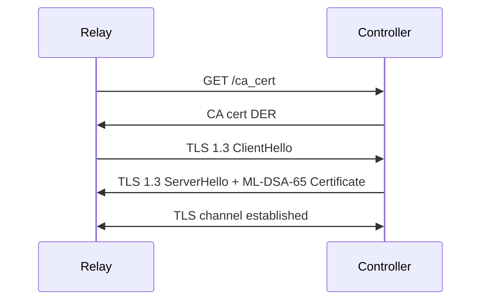

# QKD Relay System with Hybrid Post-Quantum Cryptography

A secure quantum key distribution (QKD) relay system implementing hybrid post-quantum cryptography (PQC) for authentication and key exchange. The system supports heterogeneous deployment with Python-based repetitors and RISC-V Keystone enclave-based repetitors.

## Table of Contents

- [Overview](#overview)
- [Security Architecture](#security-architecture)
  - [Two Security Domains](#two-security-domains)
  - [Cryptographic Algorithms](#cryptographic-algorithms)
- [System Components](#system-components)
- [Protocol Specifications](#protocol-specifications)
  - [Controller-Repetitor Protocol](#controller-repetitor-protocol)
  - [Repetitor-Repetitor Protocol (PQC Channel)](#repetitor-repetitor-protocol-pqc-channel)
  - [QKD Key Management Protocol](#qkd-key-management-protocol)
  - [Message Relay Protocol](#message-relay-protocol)
- [Implementation Details](#implementation-details)
  - [WolfSSL Integration](#wolfssl-integration)
  - [Keystone Enclave Constraints](#keystone-enclave-constraints)
  - [Problems Solved](#problems-solved)
- [Build Instructions](#build-instructions)
- [Deployment](#deployment)
- [File Reference](#file-reference)
- [Troubleshooting](#troubleshooting)

---

## Overview

The QKD Relay System enables secure message transmission across a chain of relay nodes (repetitors), combining:

- **Quantum Key Distribution (QKD)**: Hardware-derived symmetric keys from quantum key management entities (KMEs)
- **Post-Quantum Cryptography (PQC)**: ML-DSA-65 for digital signatures and authentication; WolfSSL TLS 1.3 for transport
- **Trusted Execution Environments**: RISC-V Keystone enclaves for hardware-isolated cryptographic operations

```
┌─────────────────────────────────────────────────────────────────────────────────┐
│                           QKD Relay System Overview                              │
├─────────────────────────────────────────────────────────────────────────────────┤
│                                                                                  │
│    ┌──────────┐         ┌──────────┐         ┌──────────┐         ┌──────────┐  │
│    │  Client  │◄───────►│   DR0    │◄───────►│   DR1    │◄───────►│   DR2    │  │
│    │          │   PQC   │ (Python) │   PQC   │ (RISC-V) │   PQC   │ (Python) │  │
│    └──────────┘         └────┬─────┘         └────┬─────┘         └────┬─────┘  │
│                              │                    │                    │         │
│                              │ RSA/TLS            │ RSA/TLS            │ RSA/TLS │
│                              ▼                    ▼                    ▼         │
│                         ┌─────────┐          ┌─────────┐          ┌─────────┐   │
│                         │  KME 0  │          │  KME 1  │          │  KME 2  │   │
│                         │  (QKD)  │◄────────►│  (QKD)  │◄────────►│  (QKD)  │   │
│                         └─────────┘  Quantum └─────────┘  Quantum └─────────┘   │
│                                       Link              Link                     │
│                                                                                  │
│    ┌──────────────────────────────────────────────────────────────────────────┐ │
│    │                           Controller                                      │ │
│    │  • PQC CA Management    • Certificate Signing    • Configuration         │ │
│    └──────────────────────────────────────────────────────────────────────────┘ │
│                                                                                  │
└─────────────────────────────────────────────────────────────────────────────────┘
```

---

## Security Architecture

### Two Security Domains

The system operates across two distinct security domains, each with its own trust model and cryptographic infrastructure:

#### 1. QKD Security Domain (RSA/Classical)

**Purpose**: Secure communication with Quantum Key Management Entities (KMEs) to retrieve quantum-derived symmetric keys.

**Characteristics**:
- Uses **RSA-2048** certificates signed by a traditional X.509 CA
- **TLS 1.2/1.3** for transport security to KME endpoints
- Follows **ETSI GS QKD 014** API specification
- Keys are derived from quantum random number generation and quantum key distribution protocols

**Trust Model**:
- Each repetitor has left/right RSA certificates for adjacent KME links
- Certificates are signed by CFSSL (CloudFlare's PKI toolkit)
- KME authenticates repetitors via mutual TLS (mTLS)

**Data Flow**:
```
┌────────────┐                    ┌─────────────┐
│ Repetitor  │                    │     KME     │
│            │                    │             │
│ ┌────────┐ │   TLS + mTLS       │ ┌─────────┐ │
│ │RSA Cert│─┼───────────────────►│ │QKD Keys │ │
│ │RSA Key │ │                    │ │         │ │
│ └────────┘ │◄───────────────────┼─│ ETSI API│ │
│            │   Symmetric Key    │ └─────────┘ │
└────────────┘                    └─────────────┘
```

**Security Properties**:
- Information-theoretic security of QKD keys (cannot be broken even with unlimited compute)
- Classical authentication via RSA (vulnerable to future quantum computers)
- Keys consumed immediately (one-time use)

#### 2. PQC Security Domain (Post-Quantum)

**Purpose**: Secure communication between repetitors and with end clients, resistant to quantum computer attacks.

**Characteristics**:
- Uses **ML-DSA-65** (Dilithium) for digital signatures and X.509 certificate authentication
- **WolfSSL TLS 1.3** with ML-DSA-65 X.509 certificates for all PQC channels
- All inter-repetitor and client-repetitor communication uses PQC mTLS

**Trust Model**:
- Dedicated PQC Certificate Authority (CA) using ML-DSA-65
- Each repetitor receives a PQC certificate signed by the CA
- Mutual authentication via PQC certificate exchange during handshake

**Data Flow**:
```
┌────────────────┐                      ┌────────────────┐
│  Repetitor A   │                      │  Repetitor B   │
│                │                      │                │
│ ┌────────────┐ │   WolfSSL TLS 1.3    │ ┌────────────┐ │
│ │ PQC Cert   │─┼─────── mTLS ────────►│ │ PQC Cert   │ │
│ │ ML-DSA Key │ │   (ML-DSA-65 certs)  │ │ ML-DSA Key │ │
│ └────────────┘ │◄────────────────────┼─└────────────┘ │
└────────────────┘                      └────────────────┘
```

**Security Properties**:
- Computational security based on lattice problems (MLWE/MSIS)
- Resistant to known quantum algorithms (Shor's, Grover's)
- Forward secrecy via TLS 1.3 ephemeral key exchange

#### Security Domain Interaction

The two domains work together to provide defense-in-depth:

```
┌─────────────────────────────────────────────────────────────────────┐
│                        Message Security Layers                       │
├─────────────────────────────────────────────────────────────────────┤
│                                                                      │
│   Original Message                                                   │
│         │                                                            │
│         ▼                                                            │
│   ┌─────────────────────────────────────────┐                       │
│   │ Layer 1: QKD Encryption (XOR)           │ ◄── Quantum-derived   │
│   │ message ⊕ qkd_key                       │     symmetric key     │
│   └─────────────────────────────────────────┘     (256-bit)         │
│         │                                                            │
│         ▼                                                            │
│   ┌─────────────────────────────────────────┐                       │
│   │ Layer 2: PQC Channel (TLS 1.3)          │ ◄── WolfSSL TLS 1.3   │
│   │ Transport encrypted by TLS 1.3          │     ML-DSA-65 auth    │
│   │ Authenticated with ML-DSA-65 X.509 cert │                       │
│   └─────────────────────────────────────────┘                       │
│         │                                                            │
│         ▼                                                            │
│   Transmitted over network                                           │
│                                                                      │
│   Security: Attacker must break BOTH QKD AND PQC to read message    │
│                                                                      │
└─────────────────────────────────────────────────────────────────────┘
```

**Why Two Domains?**

| Threat | QKD Domain Protection | PQC Domain Protection |
|--------|----------------------|----------------------|
| Classical computer attack | ✓ Information-theoretic | ✓ Computational |
| Quantum computer attack | ✓ Information-theoretic | ✓ Lattice-based |
| Man-in-the-middle | ✗ (RSA vulnerable) | ✓ (ML-DSA secure) |
| Key exhaustion | ✗ (limited key rate) | ✓ (unlimited) |

### Cryptographic Algorithms

| Purpose | Algorithm | Security Level | Key/Signature Size |
|---------|-----------|----------------|-------------------|
| Digital Signatures | ML-DSA-65 (Dilithium) | NIST Level 3 | PK: 1,952B, SK: 4,032B, Sig: 3,309B |
| PQC Channel Transport | WolfSSL TLS 1.3 | 128-bit PQ | — (ECDHE/X25519 within TLS) |
| QKD Relay Encryption | AES-256-CBC | 256-bit | 32B key, 16B IV |
| QKD Key Application | One-Time Pad (XOR) | Information-theoretic | 256-bit key |
| KME Authentication | RSA-2048 | 112-bit classical | 256B signature |

---

## System Components

### Controller (`controller_hybrid.py`)

The central management component responsible for:

- **PQC CA Management**: Holds the ML-DSA-65 CA private key, signs repetitor certificates
- **RSA CA Proxy**: Forwards RSA CSRs to CFSSL for signing
- **Configuration Distribution**: Provides network topology and KME endpoints to repetitors
- **Registration**: Authenticates repetitors via nonce-based attestation (SHA-256 challenge-response)

### Repetitors (`repetitor_hybrid.py`, `eapp_final.c`)

Relay nodes that forward encrypted messages:

- **Python Repetitors (DR0, DR2)**: Standard Linux processes using liboqs + WolfSSL
- **RISC-V Repetitors (DR1)**: Keystone enclave using WolfSSL only

Each repetitor:
1. Registers with controller and obtains certificates
2. Establishes PQC channels with adjacent repetitors
3. Retrieves QKD keys from KMEs via mTLS
4. Performs decrypt-reencrypt relay operations

### Test Client (`test_client_pqc.py`)

End-user client for sending/receiving messages:

- Generates PQC keypair and obtains certificate from CA
- Establishes PQC channel with edge repetitor
- Sends encrypted messages into the relay chain

### PQC CA Generator (`generate_pqc_ca.py`)

Standalone tool to create the PQC Certificate Authority:

- Generates ML-DSA-65 CA keypair
- Creates self-signed CA certificate
- Outputs PEM-encoded files for use by controller

---

## Protocol Specifications

### Controller-Repetitor Protocol

All controller-repetitor communication runs inside a **WolfSSL TLS 1.3 tunnel** with server-only authentication. The controller presents its own ML-DSA-65 X.509 certificate (signed by the PQC CA); repetitors verify it manually after the handshake using raw WolfCrypt ML-DSA-65 verification. Inside the tunnel, all messages are plain JSON — no additional encryption layer.

**Two ports on the controller**:
- **Port 8000** (HTTP, FastAPI): public bootstrap endpoint only — `GET /ca_cert` returns the PQC CA cert DER and `GET /health` for liveness checks.
- **Port 8001** (WolfSSL TLS 1.3): all protocol steps — register, attest, configuration retrieval, certificate generation.

#### Bootstrap + TLS Setup

```
┌───────────────┐                                    ┌──────────────┐
│   Repetitor   │                                    │  Controller  │
└───────┬───────┘                           port 8000 └──────┬───────┘
        │                                                    │
        │  GET /ca_cert  (plain HTTP)                        │
        │───────────────────────────────────────────────────►│
        │◄── CA cert DER (binary) ───────────────────────────│
        │                                                    │
        │         (CA cert is public — no auth needed)       │
        │                                             port 8001
        │  TCP connect                                       │
        │  ─────── TLS 1.3 ClientHello ─────────────────────►│
        │◄─────── TLS 1.3 ServerHello + Certificate ─────────│
        │            [controller ML-DSA-65 cert DER]         │
        │                                                    │
        │  Manual verify: _pqc_verify_peer(ssl, ca_der)      │
        │  → parse TBSCertificate, extract sig BIT STRING    │
        │  → extract CA pubkey from ca_der                   │
        │  → wc_dilithium_verify_msg(tbs, sig, ca_pk)        │
        │                                                    │
        │  ══════════ TLS tunnel established ═══════════════ │
        │                                                    │
```



All subsequent messages are sent as **length-prefixed JSON** inside the TLS tunnel:

```
┌──────────────┬──────────────────────────────────────────────────┐
│  Length (4B) │   TLS-encrypted JSON                             │
│  Big-endian  │   {"action": "<name>", "data": {...}}            │
└──────────────┴──────────────────────────────────────────────────┘
```

#### Phase 1: Registration + Attestation (inside TLS)

The repetitor authenticates itself using a nonce-based SHA-256 challenge-response. No ML-KEM or AES session key is used — all messages are plain JSON inside the TLS tunnel.

```
┌───────────────┐                                    ┌──────────────┐
│   Repetitor   │                              (TLS) │  Controller  │
└───────┬───────┘                                    └──────┬───────┘
        │                                                   │
        │  sendmsg {                                        │
        │    "action": "register",                          │
        │    "data": {                                      │
        │      "repetitor_id": "DR1",                       │
        │      "repetitor_url": "127.0.0.1:9001"            │
        │    }                                              │
        │  }                                                │
        │──────────────────────────────────────────────────►│
        │                                                   │  Generate 32-byte random nonce
        │  recvmsg { "nonce": "<hex>" }                     │
        │◄──────────────────────────────────────────────────│
        │                                                   │
        │  attestation = SHA256(nonce_hex + repetitor_id)   │
        │                                                   │
        │  sendmsg {                                        │
        │    "action": "attest",                            │
        │    "data": {                                      │
        │      "repetitor_id": "DR1",                       │
        │      "attestation_report":                        │
        │        "attestation_report:<sha256_hex>"          │
        │    }                                              │
        │  }                                                │
        │──────────────────────────────────────────────────►│
        │                                                   │  Verify SHA256(nonce_hex + repetitor_id)
        │  recvmsg { "status": "authenticated" }            │
        │◄──────────────────────────────────────────────────│
        │                                                   │
```

**Attestation Computation** (Python and C):
```python
# Python (repetitor_hybrid.py)
report = hashlib.sha256(nonce_hex.encode() + repetitor_id.encode()).hexdigest()
```
```c
/* C (eapp_final.c — get_attestation_report) */
SHA256_Update(&ctx, nonce, strlen(nonce));
SHA256_Update(&ctx, repetitor_id, strlen(repetitor_id));
```

#### Phase 2: Configuration Retrieval (inside TLS)

```
┌───────────────┐                                    ┌──────────────┐
│   Repetitor   │                              (TLS) │  Controller  │
└───────┬───────┘                                    └──────┬───────┘
        │                                                   │
        │  sendmsg {                                        │
        │    "action": "configuration",                     │
        │    "data": { "repetitor_id": "DR1" }              │
        │  }                                                │
        │──────────────────────────────────────────────────►│
        │                       [blocks until all 3 repetitors
        │                        have authenticated]        │
        │  recvmsg {                                        │
        │    "left_repetitor_url": "127.0.0.1:9000",        │
        │    "right_repetitor_url": "127.0.0.1:9002",       │
        │    "left_kme": "link0-left.kme.example.com",      │
        │    "left_kme_url": "10.0.0.1",                    │
        │    "pqc_ca_certificate": "<PEM>",                 │
        │    ...                                            │
        │  }                                                │
        │◄──────────────────────────────────────────────────│
        │                                                   │
```

#### Phase 3: Certificate Generation (inside TLS)

```
┌───────────────┐                                    ┌──────────────┐
│   Repetitor   │                              (TLS) │  Controller  │
└───────┬───────┘                                    └──────┬───────┘
        │                                                   │
        │  Generate ML-DSA-65 keypair for PQC identity      │
        │  Generate RSA-2048 keypairs for KME auth          │
        │                                                   │
        │  sendmsg {                                        │
        │    "action": "generate_certificates",             │
        │    "data": {                                      │
        │      "repetitor_id": "DR1",                       │
        │      "pqc_csr": {                                 │
        │        "subject_cn": "DR1",                       │
        │        "public_key": base64(mldsa_pk)             │
        │      },                                           │
        │      "left_rsa_csr": "<PKCS#10 PEM>",             │
        │      "right_rsa_csr": "<PKCS#10 PEM>"             │
        │    }                                              │
        │  }                                                │
        │──────────────────────────────────────────────────►│
        │                                                   │  Sign PQC cert with ML-DSA CA key
        │                                                   │  Forward RSA CSRs to CFSSL
        │  recvmsg {                                        │
        │    "pqc_certificate": "<PQC cert PEM>",           │
        │    "left_rsa_certificate": "<X.509 PEM>",         │
        │    "right_rsa_certificate": "<X.509 PEM>"         │
        │  }                                                │
        │◄──────────────────────────────────────────────────│
        │                                                   │
        │  (close TLS connection)                           │
        │                                                   │
```

#### Controller Certificate

At startup the controller generates its own ephemeral ML-DSA-65 X.509 certificate signed by the PQC CA:

```python
def generate_controller_cert():
    ctrl_pk, ctrl_sk = mldsa_generate_keypair()
    CTRL_CERTIFICATE = build_dilithium_x509_cert_pem(
        subject_cn="QKD Relay Controller",
        public_key=ctrl_pk,
        issuer_cn=PQC_CA_SUBJECT_CN,
        ca_sk=PQC_CA_PRIVATE_KEY,
        ...
    )
```

The cert is in-memory only; repetitors verify it using the CA cert fetched via `GET /ca_cert`.

#### TLS Context Variants

| Context | C function | Python function | Use |
|---------|-----------|----------------|-----|
| mTLS client (rep↔rep) | `pqc_make_tls_ctx(is_server=0, ...)` | `pqc_tls_client_connect()` | Repetitor connects to peer repetitor |
| mTLS server (rep↔rep) | `pqc_make_tls_ctx(is_server=1, ...)` | `pqc_tls_server_accept()` | Repetitor accepts peer connection |
| Server-only client (ctrl) | `ctrl_make_tls_ctx(ca_der, ca_len)` | `pqc_tls_client_connect_anon()` | Repetitor connects to controller |
| Server-only server (ctrl) | — (in `controller_hybrid.py`) | `pqc_tls_server_accept_anon_client()` | Controller accepts repetitor |

### Repetitor-Repetitor Protocol (WolfSSL mTLS PQC Channel)

Inter-repetitor communication uses **WolfSSL TLS 1.3** mutual authentication with **ML-DSA-65 X.509 certificates**. This replaces the earlier custom JSON-based ML-KEM handshake. The TLS stack handles the key exchange (ECDHE or X25519 within TLS 1.3); ML-DSA-65 provides authentication.

#### Components

| Side | Implementation | File |
|------|----------------|------|
| Python server | `pqc_tls_server_accept()` | `wolfssl_mldsa.py` |
| Python client | `pqc_tls_client_connect()` | `wolfssl_mldsa.py` |
| C enclave server | `pqc_receive_message()` | `eapp_final.c` |
| C enclave client | `pqc_send_message()` | `eapp_final.c` |
| Low-level TLS ctx | `pqc_make_tls_ctx()` / `pqc_tls_server_new()` / `pqc_tls_client_new()` | `wolfssl_mldsa.c` |

#### Handshake Sequence

```
┌────────────────┐                              ┌────────────────┐
│ Client (DR0)   │                              │ Server (DR1)   │
│  Python        │                              │  C / Enclave   │
└───────┬────────┘                              └───────┬────────┘
        │                                               │
        │  os.set_blocking(fd, True)                    │
        │  pqc_tls_client_new(cert, pkcs8_key, ca)      │
        │                                               │
        │  ────── TLS 1.3 ClientHello ────────────────► │
        │                                               │  wolfSSL_CTX_new()
        │                                               │  use_certificate_buffer()
        │                                               │  use_PrivateKey_buffer()
        │                                               │  load_verify_buffer()
        │                                               │  SetVerifyCallback(_pqc_verify_accept_all)
        │  ◄───── TLS 1.3 ServerHello + Certificate ─── │
        │          [ML-DSA-65 cert DER]                 │
        │                                               │
        │  wolfSSL_connect() succeeds                   │  wolfSSL_accept() succeeds
        │                                               │
        │  ══ Post-handshake verification ══════════════╪═══════════════════════
        │                                               │
        │  peer_cert_der = pqc_tls_peer_cert_der()     │  peer_cert_der = wolfSSL_get_peer_certificate()
        │  verify_cert_der(peer_cert, ca_der)           │  _pqc_verify_peer(ssl, ca_der, ca_der_len)
        │    • Parse TBSCertificate bytes               │    • DER parse: TBSCertificate, sig BIT STRING
        │    • Parse BIT STRING signature               │    • Extract CA pubkey from ca_der
        │    • Extract CA pubkey from ca_der            │    • wc_dilithium_verify_msg(tbs, sig, ca_pk)
        │    • mldsa_verify(tbs, sig, ca_pk)            │
        │                                               │
        │  ══ Verified channel ═══════════════════════════════════════════════
        │                                               │
```

#### Why a Custom Verify Callback?

WolfSSL's built-in `CertManagerVerifyBuffer()` returns **`ASN_SIG_CONFIRM_E` (-155)** when verifying ML-DSA-65 X.509 certificate signatures — the OID is not yet wired into WolfSSL's ASN.1 verify path at the same level as RSA/ECDSA.

The workaround is a two-step approach:

1. **Step 1 — always-accept callback**: Register `_pqc_verify_accept_all` as the TLS verify callback so WolfSSL completes the handshake without rejecting the peer cert.

   ```c
   /* wolfssl_mldsa.c */
   static int _pqc_verify_accept_all(int preverify, WOLFSSL_X509_STORE_CTX *ctx) {
       (void)preverify; (void)ctx;
       return 1;   /* always accept — manual verification follows */
   }

   wolfSSL_CTX_set_verify(ctx,
       WOLFSSL_VERIFY_PEER | WOLFSSL_VERIFY_FAIL_IF_NO_PEER_CERT,
       _pqc_verify_accept_all);
   ```

2. **Step 2 — manual post-handshake verification**: After `wolfSSL_accept` / `wolfSSL_connect` returns success, extract the peer's raw DER certificate and verify the ML-DSA-65 signature using raw WolfCrypt Dilithium:

   ```c
   /* eapp_final.c — _pqc_verify_peer() */
   static int _pqc_verify_peer(WOLFSSL *ssl,
                               const unsigned char *ca_der, int ca_der_len) {
       WOLFSSL_X509 *x = wolfSSL_get_peer_certificate(ssl);
       const unsigned char *der_buf; int der_len;
       der_buf = wolfSSL_X509_get_der(x, &der_len);

       /* DER parse: skip outer SEQUENCE, extract TBSCertificate bytes */
       /* Extract BIT STRING signature from cert */
       /* Extract SubjectPublicKeyInfo → BIT STRING from CA cert */
       /* Verify with raw Dilithium */
       wc_dilithium_init_id(&key, WC_ML_DSA_65, NULL, NULL, INVALID_DEVID);
       wc_dilithium_import_public(ca_pk, ca_pk_len, &key);
       wc_dilithium_verify_msg(sig, sig_len, tbs, tbs_len, &verified, &key);
       return (verified == 1) ? 0 : -1;
   }
   ```

   Python equivalent in `wolfssl_mldsa.py`:
   ```python
   def verify_cert_der(cert_der: bytes, ca_der: bytes) -> bool:
       """Manually verify ML-DSA-65 X.509 DER cert against CA DER cert."""
       # Parse TBSCertificate bytes and signature from cert_der
       # Parse CA SubjectPublicKeyInfo from ca_der
       verifier = Signature("ML-DSA-65")
       return verifier.verify(tbs_bytes, sig_bytes, ca_pk)
   ```

#### PKCS#8 Private Key Format

`wolfSSL_CTX_use_PrivateKey_buffer()` requires the key in **PKCS#8 DER** format, not raw ML-DSA-65 format. WolfCrypt provides `wc_Dilithium_PrivateKeyToDer()` to perform this conversion:

```c
/* wolfssl_mldsa.c */
int mldsa_privkey_to_pkcs8_der(const unsigned char *raw_sk, unsigned int sk_len,
                               unsigned char *out, unsigned int out_len) {
    dilithium_key key;
    wc_dilithium_init_id(&key, WC_ML_DSA_65, NULL, NULL, INVALID_DEVID);
    wc_dilithium_import_private(raw_sk, sk_len, &key);
    return wc_Dilithium_PrivateKeyToDer(&key, out, out_len);
}
```

Python wrapper:
```python
# wolfssl_mldsa.py
def pkcs8_mldsa65_der(raw_sk: bytes) -> bytes:
    """Convert raw 4032-byte ML-DSA-65 private key to PKCS#8 DER."""
    sk_arr = (ctypes.c_ubyte * len(raw_sk))(*raw_sk)
    out = (ctypes.c_ubyte * 8192)()
    n = _lib.mldsa_privkey_to_pkcs8_der(sk_arr, len(raw_sk), out, 8192)
    if n <= 0:
        raise RuntimeError(f"mldsa_privkey_to_pkcs8_der failed: {n}")
    return bytes(out[:n])
```

#### Non-Blocking Socket Fix (Python Side)

Python sockets created by `socket.accept()` or `socket.create_connection()` with a timeout are placed in non-blocking mode internally. WolfSSL requires **blocking** file descriptors for its I/O loop. Passing a non-blocking fd causes `wolfSSL_connect` to immediately return `SSL_ERROR_WANT_READ`.

Fix applied in both `pqc_tls_server_accept()` and `pqc_tls_client_connect()`:
```python
os.set_blocking(fd, True)   # must precede any wolfSSL call on the fd
```

#### Message Framing

After handshake, all messages use a 4-byte big-endian length-prefixed frame:

```
┌──────────────┬─────────────────────────────────────────────┐
│  Length (4B) │           TLS-encrypted Payload             │
│  Big-endian  │  (WolfSSL handles AES-256-GCM internally)   │
└──────────────┴─────────────────────────────────────────────┘

Python:
  conn.sendmsg(data)          # struct.pack(">I", len) + data
  data = conn.recvmsg()       # read 4-byte header, then payload

C:
  pqc_send_message(...)       # 4-byte header + wolfSSL_write()
  pqc_receive_message(...)    # wolfSSL_read() 4-byte header + wolfSSL_read() payload
```

### QKD Key Management Protocol

Repetitors communicate with KMEs using the **ETSI GS QKD 014** API over mutual TLS (mTLS).

#### Authentication Setup

Each repetitor has RSA certificates for its KME links:

```
DR1 (middle repetitor):
├── left_kme_cert.pem    → Authenticates to link0 KME
├── left_kme_key.pem
├── right_kme_cert.pem   → Authenticates to link1 KME  
└── right_kme_key.pem
```

#### Key Retrieval (Sender Side)

```
┌───────────────┐                                    ┌─────────────┐
│   Repetitor   │                                    │     KME     │
└───────┬───────┘                                    └──────┬──────┘
        │                                                   │
        │  TLS Handshake with mTLS                          │
        │  Client cert: link0-sae-right.pem                 │
        │  Client key:  link0-sae-right-key.pem             │
        │◄─────────────────────────────────────────────────►│
        │                                                   │
        │  GET /api/v1/keys/{peer_sae_id}/enc_keys          │
        │  ?number=1&size=256                               │
        │──────────────────────────────────────────────────►│
        │                                                   │
        │  Response:                                        │
        │  {                                                │
        │    "keys": [                                      │
        │      {                                            │
        │        "key_ID": "550e8400-e29b-41d4-...",        │
        │        "key": "base64(256-bit-key)"               │
        │      }                                            │
        │    ]                                              │
        │  }                                                │
        │◄──────────────────────────────────────────────────│
        │                                                   │
```

#### Key Retrieval (Receiver Side)

When receiving a message with a QKD key ID:

```
┌───────────────┐                                    ┌─────────────┐
│   Repetitor   │                                    │     KME     │
└───────┬───────┘                                    └──────┬──────┘
        │                                                   │
        │  POST /api/v1/keys/{master_sae_id}/dec_keys       │
        │  {                                                │
        │    "key_IDs": [                                   │
        │      {"key_ID": "550e8400-e29b-41d4-..."}         │
        │    ]                                              │
        │  }                                                │
        │──────────────────────────────────────────────────►│
        │                                                   │
        │  Response:                                        │
        │  {                                                │
        │    "keys": [                                      │
        │      {                                            │
        │        "key_ID": "550e8400-e29b-41d4-...",        │
        │        "key": "base64(256-bit-key)"               │
        │      }                                            │
        │    ]                                              │
        │  }                                                │
        │◄──────────────────────────────────────────────────│
        │                                                   │
```

#### QKD Key Application

```python
def apply_qkd_encryption(plaintext: bytes, qkd_key: bytes) -> bytes:
    """XOR plaintext with QKD key (one-time pad style)."""
    # Extend key if needed (or use as AES key)
    if len(plaintext) <= len(qkd_key):
        return bytes(a ^ b for a, b in zip(plaintext, qkd_key))
    else:
        # Use QKD key as AES key for longer messages
        cipher = AES.new(qkd_key, AES.MODE_CBC, iv=random_iv)
        return cipher.encrypt(pad(plaintext))
```

### Message Relay Protocol

#### End-to-End Message Flow

```
┌────────┐      ┌──────┐      ┌──────┐      ┌──────┐      ┌────────┐
│ Client │      │ DR0  │      │ DR1  │      │ DR2  │      │ Target │
└───┬────┘      └──┬───┘      └──┬───┘      └──┬───┘      └───┬────┘
    │              │             │             │              │
    │  PQC Handshake             │             │              │
    │◄────────────►│             │             │              │
    │              │             │             │              │
    │  Send Message M            │             │              │
    │  {                         │             │              │
    │    payload: AES(M),        │             │              │
    │    sender: "client",       │             │              │
    │    recipient: "target"     │             │              │
    │  }                         │             │              │
    │─────────────►│             │             │              │
    │              │             │             │              │
    │              │ 1. Decrypt PQC envelope   │              │
    │              │ 2. Get QKD key from KME0  │              │
    │              │ 3. XOR encrypt with QKD   │              │
    │              │ 4. PQC handshake with DR1 │              │
    │              │◄───────────►│             │              │
    │              │ 5. Forward re-encrypted   │              │
    │              │─────────────►│             │              │
    │              │             │             │              │
    │              │             │ 1. Decrypt PQC            │
    │              │             │ 2. XOR decrypt (QKD from KME0)
    │              │             │ 3. Get new QKD key (KME1) │
    │              │             │ 4. XOR encrypt with new QKD
    │              │             │ 5. PQC handshake with DR2 │
    │              │             │◄───────────►│              │
    │              │             │ 6. Forward   │              │
    │              │             │─────────────►│              │
    │              │             │             │              │
    │              │             │             │ 1. Decrypt PQC
    │              │             │             │ 2. XOR decrypt
    │              │             │             │ 3. Deliver to target
    │              │             │             │─────────────►│
    │              │             │             │              │
    │◄─────────────┼─────────────┼─────────────┼──────────────│
    │     ACK      │     ACK     │     ACK     │     ACK      │
    │              │             │             │              │
```

#### Message Structure

```json
{
  "version": 1,
  "message_id": "uuid",
  "sender": "test_client",
  "recipient": "target_service",
  "timestamp": "2026-02-04T12:00:00Z",
  "direction": "left_to_right",
  "qkd_key_id": "550e8400-e29b-41d4-a716-446655440000",
  "payload": "<base64 encrypted data>",
  "signature": "<base64 ML-DSA signature over above fields>"
}
```

#### Relay Processing at Each Hop

```python
def relay_message(incoming_msg, direction):
    # 1. Receive message over WolfSSL mTLS PQC channel (TLS handles decryption)
    plaintext = incoming_msg  # delivered as plaintext by TLS layer
    msg = json.loads(plaintext)
    
    # 2. Verify signature
    verify_signature(msg)
    
    # 3. Decrypt QKD layer (if present)
    if msg.get("qkd_key_id"):
        qkd_key = fetch_qkd_key(kme_url, msg["qkd_key_id"])
        payload = xor_decrypt(msg["payload"], qkd_key)
    else:
        payload = msg["payload"]
    
    # 4. Get new QKD key for next hop
    new_qkd_key, new_key_id = request_qkd_key(next_kme_url)
    
    # 5. Encrypt with new QKD key
    encrypted_payload = xor_encrypt(payload, new_qkd_key)
    
    # 6. Build outgoing message
    outgoing = {
        **msg,
        "qkd_key_id": new_key_id,
        "payload": encrypted_payload,
    }
    
    # 7. Sign and send via PQC channel
    outgoing["signature"] = sign(outgoing, my_mldsa_key)
    pqc_send(next_peer, outgoing)
```

---

## Implementation Details

### WolfSSL Integration

#### Problem: liboqs vs WolfSSL Incompatibility

The original system used:
- **Python components**: liboqs for both ML-KEM and ML-DSA
- **C enclave**: WolfSSL for both ML-KEM and ML-DSA

This caused **signature verification failures** because liboqs and WolfSSL produce incompatible ML-DSA signatures despite both implementing FIPS 204.

#### Solution: Unified WolfSSL for ML-DSA

All components now use WolfSSL for ML-DSA signatures:

```
┌─────────────────────────────────────────────────────────────────────────────┐
│                     Cryptographic Library Architecture                       │
├─────────────────────────────────────────────────────────────────────────────┤
│                                                                              │
│  Python Components              RISC-V Enclave                              │
│  ┌─────────────────────────┐    ┌─────────────────────────┐                 │
│  │ ML-DSA-65:              │    │ ML-DSA-65:              │                 │
│  │   WolfSSL via ctypes    │◄──►│   WolfSSL native        │                 │
│  │   (libwolfssl_mldsa.so) │    │   (libwolfssl.a)        │                 │
│  │                         │    │                         │                 │
│  │ TLS 1.3 (mTLS):         │    │ TLS 1.3 (mTLS):         │                 │
│  │   WolfSSL via ctypes    │◄──►│   WolfSSL native        │                 │
│  └─────────────────────────┘    └─────────────────────────┘                 │
│                                                                              │
│  ✓ ML-DSA signatures are fully compatible across Python and C               │
│  ✓ Unified WolfSSL crypto stack — no liboqs dependency for PQC auth        │
│                                                                              │
└─────────────────────────────────────────────────────────────────────────────┘
```

#### Python Wrapper (`wolfssl_mldsa.py`)

The file provides both low-level ML-DSA primitives and a high-level mTLS connection API:

```python
import ctypes
from pathlib import Path

_lib = ctypes.CDLL(str(Path(__file__).parent / "libwolfssl_mldsa.so"))

class Signature:
    """Drop-in replacement for oqs.Signature for ML-DSA-65."""

    def __init__(self, algorithm="ML-DSA-65", secret_key=None):
        self.details = {
            "length_public_key": 1952,
            "length_secret_key": 4032,
            "length_signature": 3309,
        }
        self._pk = None
        self._sk = secret_key

    def generate_keypair(self) -> bytes:
        """Generate ML-DSA-65 keypair, return public key."""
        ...

    def sign(self, message: bytes) -> bytes:
        """Sign message with ML-DSA-65 via wc_dilithium_sign_msg."""
        ...

    def verify(self, message: bytes, signature: bytes, public_key: bytes) -> bool:
        """Verify ML-DSA-65 signature via wc_dilithium_verify_msg."""
        ...

def pkcs8_mldsa65_der(raw_sk: bytes) -> bytes:
    """Convert raw 4032-byte ML-DSA-65 private key to PKCS#8 DER
    via wc_Dilithium_PrivateKeyToDer (required by wolfSSL_CTX_use_PrivateKey_buffer)."""
    ...

def verify_cert_der(cert_der: bytes, ca_der: bytes) -> bool:
    """Manually verify ML-DSA-65 X.509 DER cert against CA DER cert.
    Needed because wolfSSL CertManagerVerifyBuffer returns ASN_SIG_CONFIRM_E (-155)
    for ML-DSA-65 OIDs."""
    ...

class PqcTlsConn:
    """Wraps a WolfSSL mTLS connection with length-prefixed message framing."""
    def sendmsg(self, data: bytes) -> None: ...  # 4-byte big-endian length + data
    def recvmsg(self) -> bytes: ...
    def peer_cert_der(self) -> bytes: ...
    def close(self) -> None: ...

def pqc_tls_server_accept(fd, cert_der, pkcs8_der, ca_der) -> PqcTlsConn:
    """
    Perform mTLS handshake as TLS server on fd.
    1. os.set_blocking(fd, True)           # WolfSSL requires blocking I/O
    2. pqc_tls_server_new(cert, key, ca)   # create WolfSSL CTX + SSL
    3. wolfSSL_accept(fd)                  # TLS handshake
    4. verify_cert_der(peer_cert, ca_der)  # manual ML-DSA-65 cert verification
    """
    ...

def pqc_tls_client_connect(fd, cert_der, pkcs8_der, ca_der) -> PqcTlsConn:
    """
    Perform mTLS handshake as TLS client on fd.
    1. os.set_blocking(fd, True)
    2. pqc_tls_client_new(cert, key, ca)
    3. wolfSSL_connect(fd)
    4. verify_cert_der(peer_cert, ca_der)
    """
    ...

# ── Controller channel (server-only TLS — no client cert) ───────────────────

def pqc_tls_server_accept_anon_client(fd, cert_der, pkcs8_der) -> PqcTlsConn:
    """
    TLS server that does NOT request a client cert.
    Used by the controller (port 8001) to accept repetitor connections.
    1. os.set_blocking(fd, True)
    2. pqc_tls_server_anon_client_new(cert, key)  # WOLFSSL_VERIFY_NONE
    3. wolfSSL_accept(fd)
    # No peer cert verification (client is anonymous — attestation exchange authenticates them)
    """
    ...

def pqc_tls_client_connect_anon(fd, ca_der) -> PqcTlsConn:
    """
    TLS client with server-only authentication (no client cert sent).
    Used by repetitors when connecting to the controller.
    1. os.set_blocking(fd, True)
    2. pqc_tls_client_anon_new(ca_der)   # WOLFSSL_VERIFY_PEER + accept-all callback
    3. wolfSSL_connect(fd)
    4. verify_cert_der(peer_cert, ca_der)  # manual server cert verification
    """
    ...
```

#### Monkey-Patch Shim

Added to all Python files to transparently redirect ML-DSA operations:

```python
import oqs

try:
    import wolfssl_mldsa
    _original_oqs_signature = oqs.Signature

    class HybridSignature:
        def __new__(cls, algorithm, secret_key=None):
            if "DSA" in algorithm or "Dilithium" in algorithm:
                return wolfssl_mldsa.Signature(algorithm, secret_key)
            if secret_key is not None:
                return _original_oqs_signature(algorithm, secret_key)
            return _original_oqs_signature(algorithm)

    oqs.Signature = HybridSignature
    print("[*] Using WolfSSL for ML-DSA signatures")
except ImportError:
    pass  # Fall back to liboqs
```

### Keystone Enclave Constraints

The RISC-V Keystone enclave (`eapp_final.c`) runs in a **single-threaded** Trusted Execution Environment. Several glibc functions that appear harmless on Linux are unsafe in Keystone:

#### Threading / Futex Syscall

Keystone does not implement the `futex` syscall. Any code path that calls `pthread_mutex_lock` internally will trigger `abort()`, which surfaces as:

```
The futex facility returned an unexpected error code.
[Keystone] RISC-V Exception: scause: 0x3  (EBREAK — glibc abort)
```

**Affected functions**: `gethostbyname()`, `getaddrinfo()`, any liboqs function.

This is why:
- WolfSSL is built with `--enable-singlethreaded` for the enclave
- liboqs is **not** used in the enclave at all
- DNS lookups must be avoided (see below)

#### DNS Lookup Bypass (KME IP Addresses)

`gethostbyname()` uses a pthread mutex internally, which crashes in Keystone. The config JSON supplies `left_kme_url` and `right_kme_url` as pre-resolved numeric IP addresses. These are passed directly to `tcp_connect()`, which tries `inet_pton()` first — bypassing `gethostbyname()` entirely:

```c
/* eapp_final.c — tcp_connect() already calls inet_pton() first */
const char *connect_addr = (kme_ip && kme_ip[0]) ? kme_ip : kme_host;
int sock = tcp_connect(connect_addr, kme_port);

/* SNI and HTTP Host header still use the hostname for TLS/server-side routing */
wolfSSL_UseSNI(ssl, WOLFSSL_SNI_HOST_NAME, kme_host, strlen(kme_host));
/* HTTP: sprintf(req, "Host: %s\r\n", kme_host); */
```

Config JSON fields:
```json
{
  "left_kme":     "link0-left.acct-XXXX.etsi-qkd-api.qukaydee.com",
  "left_kme_url": "3.227.206.55",    // ← numeric IP used for tcp_connect
  "right_kme":    "link0-right.acct-XXXX.etsi-qkd-api.qukaydee.com",
  "right_kme_url":"52.90.11.22"      // ← numeric IP used for tcp_connect
}
```

#### System Time

Keystone enclaves may not have correct wall-clock time, causing WolfSSL to reject certificates as expired. WolfSSL for RISC-V is compiled with `-DNO_ASN_TIME` to skip date validation.

#### Build Timestamp Debugging

The startup banner includes the build timestamp to confirm the correct binary is running:

```c
/* eapp_final.c */
fprintf(stderr, "[*] WolfSSL mTLS PQC Repetitor\n");
fprintf(stderr, "Build: %s %s\n", __DATE__, __TIME__);
```

### Problems Solved

| Problem | Error / Symptom | Root Cause | Solution |
|---------|-----------------|------------|----------|
| **Signature incompatibility** | Verify always fails across implementations | liboqs ≠ WolfSSL ML-DSA byte encoding | Use WolfSSL for ML-DSA everywhere via ctypes |
| **Futex crash (liboqs)** | `syscall 98 not implemented` | liboqs uses pthreads internally | Use WolfSSL with `--enable-singlethreaded`; no liboqs in enclave |
| **Shared library PIC error** | `R_X86_64_TPOFF32 relocation` at load | WolfSSL built without `-fPIC` | Rebuild Linux WolfSSL with `-fPIC` |
| **ASN_SIG_CONFIRM_E (-155)** | `wolfSSL_accept` rejects peer cert | WolfSSL ASN.1 path doesn't handle ML-DSA OID for cert-sig verify | `_pqc_verify_accept_all` callback + manual `_pqc_verify_peer()` / `verify_cert_der()` after handshake |
| **PKCS#8 format mismatch** | `use_PrivateKey_buffer` fails | WolfSSL expects PKCS#8 DER, not raw ML-DSA key bytes | `wc_Dilithium_PrivateKeyToDer()` → `pkcs8_mldsa65_der()` wrapper |
| **Non-blocking socket** | `SSL_ERROR_WANT_READ` / `-326 record layer error` | Python socket has timeout → non-blocking fd | `os.set_blocking(fd, True)` before `pqc_tls_*` calls |
| **Futex crash (DNS)** | `scause: 0x3` during KME HTTPS request | `gethostbyname()` uses futex internally; Keystone is single-threaded | Pass numeric IP addresses (`left_kme_url`/`right_kme_url`) to `tcp_connect()` |
| **Certificate date error** | `Date BEFORE check failed` | Keystone has incorrect wall-clock time | Compile with `-DNO_ASN_TIME` |
| **Wrong binary running** | No TLS error messages; C side silently closes connection | Running `eapp_hybrid` (old binary) instead of `eapp_final` | Check banner: must show `WolfSSL mTLS PQC` and current build date |

---

## Build Instructions

### Prerequisites

```bash
# Python dependencies
pip install liboqs-python cryptography fastapi uvicorn requests

# System dependencies
sudo apt install build-essential autoconf automake libtool
```

### Build WolfSSL for Linux

```bash
cd /path/to/wolfssl
make distclean 2>/dev/null || true

CFLAGS="-fPIC -Os -ffunction-sections -fdata-sections -Wno-error" \
CPPFLAGS="-DWOLFSSL_DILITHIUM -DWOLFSSL_WC_DILITHIUM \
-DWOLFSSL_DILITHIUM_44 -DWOLFSSL_DILITHIUM_65 -DWOLFSSL_DILITHIUM_87 \
-DWOLFSSL_KYBER512 -DWOLFSSL_KYBER768 -DWOLFSSL_KYBER1024 \
-DWOLFSSL_WC_MLKEM" \
./configure \
  --prefix=$PWD/_install_linux \
  --enable-static --enable-shared \
  --enable-singlethreaded \
  --enable-dilithium --enable-kyber \
  --enable-sha3 --enable-shake256 --enable-hkdf \
  --enable-rsa --enable-aes --enable-sha256 \
  --enable-opensslextra --enable-opensslall \
  --disable-examples --disable-crypttests

make -j$(nproc) && make install
```

### Build WolfSSL for RISC-V

```bash
cd /path/to/wolfssl
CROSS=/path/to/riscv64-buildroot-linux-gnu-

CC=${CROSS}gcc AR=${CROSS}ar RANLIB=${CROSS}ranlib \
CFLAGS="-Os -ffunction-sections -fdata-sections -DNO_ASN_TIME -Wno-error" \
CPPFLAGS="-DWOLFSSL_DILITHIUM -DWOLFSSL_WC_DILITHIUM -DWOLFSSL_DILITHIUM_65 \
-DWOLFSSL_KYBER768 -DWOLFSSL_WC_MLKEM \
-DWOLFSSL_NO_ML_DSA_44 -DWOLFSSL_NO_ML_DSA_87" \
./configure \
  --host=riscv64-unknown-elf \
  --prefix=$PWD/_install_riscv \
  --enable-static --disable-shared \
  --enable-singlethreaded --disable-filesystem \
  --enable-kyber --enable-dilithium \
  --enable-sha3 --enable-shake256 --enable-hkdf \
  --enable-rsa --enable-aes --enable-sha256 --enable-sni \
  --enable-opensslextra \
  --disable-examples --disable-crypttests \
  --disable-asm --disable-fastmath --enable-debug

make -j$(nproc) && make install
```

### Build Python Shared Library

```bash
cd /path/to/qkd_client
WOLFSSL=/path/to/wolfssl/_install_linux

gcc -shared -fPIC -o libwolfssl_mldsa.so wolfssl_mldsa.c \
    -I${WOLFSSL}/include -L${WOLFSSL}/lib \
    -Wl,-rpath,${WOLFSSL}/lib \
    -lwolfssl -lm -lpthread
```

### Generate PQC CA

```bash
export LD_LIBRARY_PATH="/path/to/wolfssl/_install_linux/lib:$LD_LIBRARY_PATH"
python generate_pqc_ca.py --output-dir ./pqc_ca
```

---

## Deployment

### 1. Start Infrastructure

```bash
# Terminal 1: CFSSL (RSA CA)
cfssl serve -address=127.0.0.1 -port=8888 -ca=ca.pem -ca-key=ca-key.pem

# Terminal 2: Controller
export LD_LIBRARY_PATH="/path/to/wolfssl/_install_linux/lib:/path/to/oqs/lib"
python controller_hybrid.py \
  --pqc-ca-cert ./pqc_ca/ca_certificate.pem \
  --pqc-ca-key ./pqc_ca/ca_private_key.pem
```

### 2. Start Repetitors

```bash
# Terminal 3: Python repetitors (DR0, DR2)
python repetitor_hybrid.py 0 2

# Terminal 4: RISC-V enclave (DR1) - in QEMU
/usr/share/keystone/examples/relay.ke
```

### 3. Test

```bash
# Generate credentials
python test_client_pqc.py --generate-credentials

# Send message
python test_client_pqc.py --send --target 127.0.0.1:9000 --message "Hello!"
```

### Verification

All components should show:
```
[*] Using WolfSSL for ML-DSA signatures
```

---

## File Reference

| File | Description |
|------|-------------|
| `controller_hybrid.py` | Central controller, PQC CA management, CFSSL proxy |
| `repetitor_hybrid.py` | Python relay implementation (DR0, DR2) |
| `eapp_final.c` | RISC-V Keystone enclave relay (DR1); WolfSSL mTLS, KME HTTPS client |
| `wolfssl_mldsa.c` | C shared library: ML-DSA keygen/sign/verify, PKCS#8 export, WolfSSL TLS ctx |
| `wolfssl_mldsa.py` | Python ctypes wrapper: `Signature`, `PqcTlsConn`, `pqc_tls_server_accept`, `pqc_tls_client_connect`, `verify_cert_der`, `pkcs8_mldsa65_der` |
| `test_client_pqc.py` | End-user test client |
| `generate_pqc_ca.py` | PQC CA generator (ML-DSA-65 self-signed CA cert) |

---

## Troubleshooting

| Error / Symptom | Likely Cause | Fix |
|-----------------|--------------|-----|
| `Invalid server signature` | Python component using liboqs, not WolfSSL | Ensure `wolfssl_mldsa.py` monkey-patch shim is active; check `[*] Using WolfSSL for ML-DSA` in output |
| `syscall 98 not implemented` | liboqs linked into enclave build | Remove liboqs; use WolfSSL only in enclave |
| `The futex facility returned an unexpected error code` | `gethostbyname()` / `getaddrinfo()` called from enclave | Ensure `left_kme_url`/`right_kme_url` are numeric IPs in config JSON; check `tcp_connect()` uses them |
| `scause: 0x3` (EBREAK) in Keystone | glibc `abort()` triggered by futex failure | Same as above; rebuild WolfSSL with `--enable-singlethreaded` |
| `wolfSSL_connect failed: err=-326` | WolfSSL received non-TLS data (wrong binary running) | Verify the correct binary is running; check startup banner for `WolfSSL mTLS PQC` and today's build date |
| C server silently drops connection (no TLS errors logged) | Running `eapp_hybrid` instead of `eapp_final` | Run `./eapp_final DR1 9001`; check build timestamp in banner |
| `SSL_ERROR_WANT_READ` on Python side | Socket in non-blocking mode when passed to WolfSSL | `os.set_blocking(fd, True)` before `pqc_tls_server_accept` / `pqc_tls_client_connect` |
| `ASN_SIG_CONFIRM_E (-155)` or peer cert rejected | WolfSSL can't verify ML-DSA-65 OID in X.509 sig verify path | Use `_pqc_verify_accept_all` callback + manual `_pqc_verify_peer` / `verify_cert_der` post-handshake |
| `use_PrivateKey_buffer failed` | Raw ML-DSA key bytes passed instead of PKCS#8 DER | Use `pkcs8_mldsa65_der(raw_sk)` → `wc_Dilithium_PrivateKeyToDer()` |
| `Date BEFORE check failed` | Keystone has wrong system time | Rebuild RISC-V WolfSSL with `-DNO_ASN_TIME` |
| `R_X86_64_TPOFF32 relocation` | Linux WolfSSL shared lib built without `-fPIC` | Rebuild with `CFLAGS=-fPIC` |
| `libwolfssl_mldsa.so not found` | Shared library not on search path | `export LD_LIBRARY_PATH=/path/to/wolfssl/_install_linux/lib:$LD_LIBRARY_PATH` |
| `pqc_tls_server_new failed` or `pqc_tls_client_new failed` | CTX creation failed (cert/key load error) | Check `[ERROR] pqc_make_tls_ctx:` lines in stderr for the specific step that failed |
| `Peer certificate signature verification failed` | Manual ML-DSA-65 cert verify failed after TLS handshake | Verify the peer and CA are using matching WolfSSL-generated certs; check cert chain |

---

## References

- [NIST PQC Standards](https://csrc.nist.gov/projects/post-quantum-cryptography)
- [ETSI GS QKD 014](https://www.etsi.org/deliver/etsi_gs/QKD/001_099/014/)
- [WolfSSL Documentation](https://www.wolfssl.com/documentation/)
- [Keystone Enclave](https://keystone-enclave.org/)
- [ML-KEM (FIPS 203)](https://csrc.nist.gov/pubs/fips/203/final)
- [ML-DSA (FIPS 204)](https://csrc.nist.gov/pubs/fips/204/final)
